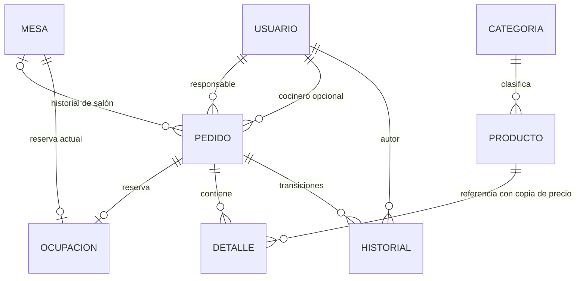

# Guion para explicar el backend en VS Code

## Idea para iniciar la sustentación

«Este proyecto implementa el backend de un restaurante. Postman, dentro de VS Code, es el
cliente de prueba: envía método, URL, token y JSON. Flask recibe la petición; el servicio
valida permisos y reglas; el driver ejecuta SQL parametrizado en una transacción. MySQL
conserva los cambios y podemos comprobarlos con Workbench. SQLite ofrece la misma lógica
cuando el computador no tiene MySQL. No hay frontend en esta entrega».

## Archivos para abrir, en orden

| Archivo | Qué explicar | Qué mostrar |
|---|---|---|
| `iniciar_api.py` | Configuración del motor/puerto, creación inicial del dueño y arranque local | `main`, opciones --motor y --crear-admin |
| `poli/api.py` | Rutas HTTP, validación de JSON, Bearer y traducción de errores a HTTP | `crear_app`, `proteger`, `datos`, `crear_pedido` |
| `poli/servicio.py` | Reglas compartidas y consultas SQL; no confía en los permisos del cliente | `_actor`, `crear_pedido`, `agregar_producto`, `_pedido`, `cambiar_estado` |
| `poli/db.py` | Driver sqlite3/mysql.connector, conexiones, commit/rollback y parámetros | `Cursor.execute`, `Base.transaccion` |
| `poli/validaciones.py` | Enteros estrictos, textos, cantidades y precio decimal | `entero`, `centavos` |
| `poli/seguridad.py` | Contraseñas derivadas con sal y comparación segura; tokens con hash | `hash_clave`, `verificar_clave`, `huella_token` |
| `poli/datos_iniciales.py` | Catálogo solicitado para presentar, una sola carga atómica por base | `cargar_catalogo` y marca CARGA_INICIAL |
| `sql/mysql_01_esquema.sql` | Relaciones, claves foráneas y restricciones | pedido, detalle, ocupacion, historial |
| `postman/PoliRestaurante.postman_collection.json` | Casos de prueba y captura automática de IDs/tokens | Carpetas 05–06 y Scripts de una petición |
| `tests/test_api.py`, `tests/test_servicio.py` | Comportamientos válidos, errores y concurrencia | Prueba de ciclo y versión obsoleta |

## Relación de los datos

Una mesa puede tener muchos pedidos históricos, pero como máximo una ocupación actual.
La PK `ocupacion.mesa_id` evita dos reservas simultáneas. El detalle conserva el precio y
nombre que tenía el producto al agregarlo. No se recalcula una venta vieja con el menú nuevo.
Las tablas restantes guardan versión del esquema, sesiones, auditoría y recibos de reintento.

## Recorrido de HU01: crear pedido

1. En Postman, 05.1 envía POST `/api/v1/pedidos`, Bearer del mesero y JSON con tipo/mesa.
2. En `poli/api.py`, `proteger` valida que el token corresponde a una sesión vigente y rol
   permitido. `datos` exige JSON con campos válidos; `clave_operacion` exige UUID del header.
3. `servicio.crear_pedido` valida SALON/LLEVAR. Dentro de `_ejecutar`, `_actor` comprueba otra
   vez identidad y permisos en la misma transacción que escribirá.
4. Determina el responsable; verifica mesa activa y sin ocupación; inserta pedido pendiente,
   reserva e historial. `_ejecutar` agrega auditoría y recibo si se usó UUID.
5. `Base.transaccion` confirma todo junto. Ante excepción, revierte todo. HTTP devuelve
   201 con ID/versión; el script de Postman los guarda para la petición siguiente.

No recibimos un `usuario_id` sin verificar para decidir quién actúa. Pasar responsable_id
solo cambia la asignación cuando el actor tiene permiso; no cambia quién inició sesión.

## Las cinco funcionalidades de Juan

| HU | Método de servicio | Demostración |
|---|---|---|
| HU01 Crear pedido | `crear_pedido` | 05.1 y conflicto de mesa 05.2 |
| HU02 Agregar productos | `agregar_producto` | 05.3–05.4, precio tomado de BD |
| HU03 Editar/quitar | `editar_detalle`, `quitar_detalle` | 05.6–05.7, recalcular total, versión |
| HU04 Marcar entregado | `cambiar_estado` con ENTREGADO | 05.13 después de cocina |
| HU05 Cancelar | `cambiar_estado` con CANCELADO | 06, motivo e historial; mesa libre |

«Estas son cinco historias de usuario, no cinco entidades CRUD distintas. Administración
incluye los CRUD de usuarios, categorías, productos y mesas; cocina aporta cola, estados y
reportes. Cada integrante debe poder explicar su bloque y las relaciones».

## Explicar HU03 con una pausa del depurador

Abre esta carpeta `backend_api`, selecciona `.venv` con **Python: Select Interpreter** e
instala las extensiones Python/Python Debugger si no existen. Crea primero el dueño.
En Run and Debug elige API · SQLite o API · MySQL y F5. No arranques además otro servidor
por terminal. Los archivos `.vscode/launch.json` ya incluyen las dos configuraciones.

Pon un breakpoint en la primera instrucción de `agregar` en `poli/api.py`, después otro
dentro de la función `accion` de `agregar_producto` en el servicio. Envía 05.3 desde Postman.
El cliente esperará mientras el depurador esté detenido. Con F10 observa `d`, `g.usuario`,
`pid`, `p`, `producto` y el SQL; con F5 continúa para que llegue la respuesta.
No expongas contraseñas/tokens al compartir la pantalla o grabar variables de autenticación.

Explica que `?` y `%s` son marcadores de parámetros: los valores viajan separados del SQL.
Los nombres de tabla dinámicos solo vienen de listas permitidas, no de texto libre del usuario.

## Concurrencia y reintentos, con ejemplo

«Si dos clientes leen version 2 y uno modifica el pedido, este pasa a version 3. La petición
del otro con version 2 recibe 409 y debe consultar de nuevo. Si se pierde una respuesta,
la misma UUID con los mismos datos devuelve el resultado original sin duplicar el pedido.
No usamos una nueva UUID hasta saber qué pasó con la anterior».

SQLite usa BEGIN IMMEDIATE; MySQL bloquea una fila técnica con FOR UPDATE. Es una solución
conservadora que serializa escrituras para la escala de esta entrega. El recibo, los datos y
la auditoría se confirman juntos. Catálogo/usuarios no tienen el mecanismo UUID y se deben
consultar ante una respuesta incierta.

## Guion de demostración de cinco minutos

1. Muestra salud/login, productos con categoría y mesas libres (00).
2. Muestra que mesero no administra categorías y cocina no crea pedidos (04).
3. Crea, agrega, edita y quita (05.1–05.8); enseña total calculado y versión.
4. Cambia a las peticiones con token_cocina: cola, preparar y listo. El mesero entrega.
5. Abre pedido e historial, mesa libre y SELECT equivalente en Workbench.
6. Ejecuta 06 para cancelar otro pedido, luego ventas/auditoría como dueño (07).

Para volver a demostrar, no recrees empleados: vuelve a login definitivo y crea nuevos
pedidos. No borres tablas para «reiniciar» delante del profesor.
