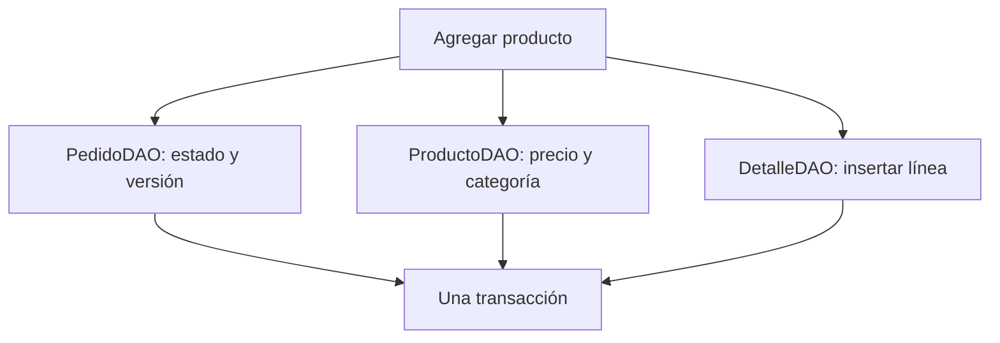

# Cómo explicar la parte de Juan Parra

## Qué se tomó del ejemplo del profesor

El archivo de personas separa HTML, CSS y módulos JavaScript. Su `app.js` ensambla el modelo,
la vista y el controlador. La presentación explica tres niveles (diapositiva 10), las
responsabilidades MVC (14–15) y el recorrido de una inserción (16–17).

Esta entrega conserva esa organización aplicada a pedidos. Se usa Bootstrap local para
formularios, botones, tablas y distribución adaptable. El dominio sigue siendo el del
restaurante: roles, estados, mesas y precios históricos. No se copia la tabla persona ni
se ejecuta su backend. Flask sigue usando SQL directo mediante driver, como la entrega
anterior. El ejemplo usa ORM, pero MVC y DAO no obligan a usar un ORM.

## MVC del navegador

| Pieza | Archivo | Responsabilidad |
|---|---|---|
| Estructura | `cliente_juan/cliente.html` | Pantallas, formularios, tabla y diálogos accesibles |
| Diseño | `cliente_juan/css/styles.css` | Paleta azul/verde, contraste, tamaños y distribución |
| Dominio cliente | `js/models/Pedido.js` | Valida tipo, cantidad, observaciones y motivo; calcula qué acciones ofrecer |
| HTTP | `js/models/ApiModel.js` | fetch, token, login, perfil, cambio de clave y errores HTTP |
| Modelo de pedidos | `js/models/PedidoModel.js` | Endpoints, versión y UUID de operaciones, recuperación de respuesta incierta |
| Vista | `js/views/PedidoView.js` | Única capa que toca el DOM, pinta datos y captura eventos |
| Controlador | `js/controllers/PedidoController.js` | Coordina formularios, modelos, permisos visibles y recarga |
| Arranque | `js/app.js` | Construye objetos y los conecta por inyección de dependencias |
| Configuración | `js/config.js` | Dirección de la API y nombres de los estados |

El modelo HTTP no conoce botones ni tablas. La vista no ejecuta fetch ni SQL. El controlador
recibe ambos por constructor, como en el ejemplo de clase. La vista avisa con callbacks y
usa delegación de eventos para los botones de las filas. Los valores del servidor se
insertan con `textContent`, evitando interpretar observaciones como HTML.

## Backend, servicio y DAO

| Pieza | Archivo | Responsabilidad |
|---|---|---|
| Entrada | `backend_api/iniciar_api.py` | Motor, puerto, configuración y creación inicial del dueño |
| API REST | `backend_api/poli/api.py` | Rutas, cuerpos JSON, Bearer, CORS y códigos HTTP |
| Servicio | `backend_api/poli/servicio.py` | Reglas, permisos, estados y coordinación transaccional |
| DAO de pedido | `backend_api/poli/dao/pedido_dao.py` | SQL de pedidos y control de versiones |
| DAO de producto | `backend_api/poli/dao/producto_dao.py` | Producto con categoría y precio real |
| DAO de detalle | `backend_api/poli/dao/detalle_dao.py` | Inserta, consulta, edita y elimina líneas |
| Driver | `backend_api/poli/db.py` | Conexiones SQLite/MySQL, parámetros, commit y rollback |

**DAO no es MVC.** MVC organiza cómo el cliente recibe acciones y muestra información.
DAO organiza cómo el servidor accede a datos. Ambos patrones pueden coexistir.
La entrega final tiene [13 DAO](../backend_api/docs/DAO_FINAL.md). El SQL del negocio
se ejecuta en esa capa; el servicio conserva las reglas y permisos.

## Una funcionalidad con varios DAO

La API invoca `Restaurante.agregar_producto` desde POST `/api/v1/pedidos/{id}/detalles`.
Dentro de `accion(c, u)`, `PedidoDAO(c)`, `ProductoDAO(c)` y `DetalleDAO(c)` usan el mismo cursor:

1. `_pedido(..., dao=pedido_dao)` llama a `PedidoDAO.obtener`. El servicio comprueba que el
   mesero sea responsable, la versión coincida y el estado sea PENDIENTE.
2. `ProductoDAO.obtener` consulta el producto junto a la categoría. El servicio comprueba
   activo/disponible y usa su precio de la base.
3. `DetalleDAO.contar` permite aplicar el límite de 100 líneas.
4. `DetalleDAO.crear` inserta cantidad/notas y copia de precio/nombres/categoría.
5. Se incrementa la versión y se registra auditoría y recibo UUID. `Base.transaccion` confirma
   todo junto. Si falla cualquier paso se revierte la operación completa.

Los DAO no se conectan entre sí: el servicio los coordina. Tampoco se les da a cada uno una
conexión independiente, porque un commit separado podría dejar una operación incompleta.
Un JOIN de dos tablas dentro de una única clase no demostraría por sí solo el uso de dos DAO.

## Recorrido desde el botón hasta la base

Abre un pedido pendiente y pulsa Agregar:

1. HTML dispara submit de `agregar-form`. La vista obtiene producto, cantidad y notas.
2. El controlador `agregar` valida con `Pedido.detalle` y `Pedido.entero`.
3. `PedidoModel.agregar` añade `version`. `mutar` conserva una UUID y el cuerpo antes de enviar.
4. `ApiModel.enviar` realiza POST con JSON, Bearer e Idempotency-Key.
5. Flask valida JSON y sesión, y llama a `Restaurante.agregar_producto`.
6. El servicio usa los tres DAO, verifica reglas y confirma SQL/auditoría juntos.
7. El modelo recibe el resultado; el controlador recarga listado y detalle; la vista pinta
   el nuevo total. Las respuestas de error se muestran sin una recarga completa de página.

La cantidad y notas se validan en cliente para ayudar al usuario y en servidor para impedir
que alguien salte las reglas desde Postman/F12. Ocultar un botón no concede ni protege permisos.

## Demostración con el depurador de VS Code

1. Abre la carpeta completa del paquete. Ya incluye `.vscode/launch.json` para SQLite/MySQL.
2. Selecciona con **Python: Select Interpreter** el Python de `backend_api/.venv`.
3. Crea primero al dueño por terminal si la base es nueva. Detén el servidor anterior
   antes de pulsar F5 para no ocupar el mismo puerto dos veces.
4. Pon un breakpoint en `PedidoDAO.obtener`, `ProductoDAO.obtener` y `DetalleDAO.crear`.
5. Elige «Juan · API con MySQL» o «Juan · API con SQLite» y F5.
6. Abre Live Server, entra como Juan y agrega un producto a una orden pendiente.
7. El depurador se detiene en los tres DAO. Observa pedido_id, producto_id y el mismo cursor.
   Continúa con F5 tras cada pausa; el navegador espera la respuesta. Si pausas más de
   15 segundos, el cliente avisará de respuesta incierta y permitirá recuperarla por UUID.
8. Comprueba la fila en Workbench o consulta el pedido desde la misma interfaz/Postman.

No muestres contraseñas ni tokens al compartir pantalla. El precio debe salir de la base,
no de un input que el cliente pueda manipular.

## Guion breve para la sustentación

«Mi parte son HU01 a HU05. El cliente está dividido en modelo, vista y controlador. Desde
esta pantalla creo pedidos y agrego productos, edito sus cantidades u observaciones y
quito líneas mientras están pendientes. Cocina prepara el pedido; después registro su
entrega. Si el cliente cancela, guardo el motivo y conservo el historial».

«Al agregar un producto, PedidoDAO recupera el pedido, ProductoDAO lee el catálogo y
DetalleDAO escribe la línea. Los tres comparten una transacción: las escrituras se
confirman juntas o se revierten juntas. Esta operación supera el mínimo de dos DAO
de la entrega de Juan. El proyecto final contiene 13».

«La interfaz oculta acciones que no corresponden al rol/estado, pero el servidor también
las valida. Si dos sesiones editan el mismo pedido, la versión evita sobrescribir cambios.
Si se pierde la respuesta, la UUID permite recuperar la operación sin duplicar productos».

## Qué mostrar de cada HU

| HU | Pantalla | Código para explicar |
|---|---|---|
| HU01 | Nuevo pedido y mesa libre | `PedidoController.crear`, `PedidoModel.crear`, `Restaurante.crear_pedido` |
| HU02 | Agregar producto | `PedidoController.agregar`, servicio y tres DAO |
| HU03 | Editar / Quitar línea | `editar`, `confirmar`, `editar_detalle`, `quitar_detalle` |
| HU04 | Pedido LISTO y Marcar entregado | Permisos de `Pedido.permisos` y transición en `cambiar_estado` |
| HU05 | Cancelar con motivo e historial | `Pedido.motivo`, `cambiar_estado`, liberación de ocupacion |

El listado y su filtro recuperan datos persistidos, con 50 pedidos por página. La búsqueda
por texto es sobre esa página y se etiqueta así. Para la operación de cocina y administración,
consulta [la guía completa](../GUIA_PRESENTACION_COMPLETA.md).
